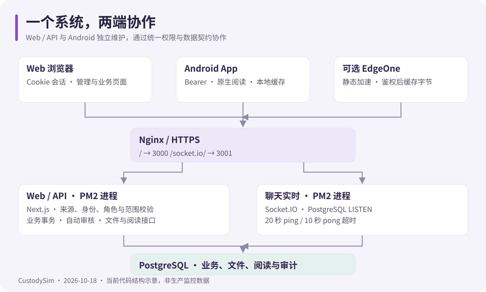

# CustodySim Web

监所日常管理的 Web / API 系统：打卡与补卡、任务办理与审核、申请逐级审批、在押档案与会签盖章、通知、聊天、图书阅读、积分与禁闭、匿名社区，并配套独立 Android 客户端（`/download` 分发 APK）。



> 文档核对日期：**2026-11-01**。Web 版本 **1.7.0**；Android 源码版本 **1.7.0（versionCode 5）**。本轮发布 Web，Android 安装包及 App Release 后续发布。

## 按角色阅读

| 你的角色          | 从这里开始                                                                                                                                               |
| ----------------- | -------------------------------------------------------------------------------------------------------------------------------------------------------- |
| 日常使用者        | [使用指南](docs/user-guide.md) · [常见问题](docs/faq.md)                                                                                                 |
| 监管人员 / 管理员 | [管理人员指南](docs/staff-guide.md) · [自动审核](docs/automatic-task-review.md)                                                                          |
| 开发者            | [开发与测试](docs/development.md) · [系统架构](docs/architecture.md) · [目录说明](docs/repository-layout.md)                                             |
| 运维人员          | [生产部署](docs/deployment.md) · [配置参考](docs/configuration.md) · [运维排障](docs/operations.md)                                                      |
| Android 维护者    | [独立 App 仓库](https://github.com/PDSB001/CustodySim-app) · [构建指南](https://github.com/PDSB001/CustodySim-app/blob/main/docs/android-development.md) |

完整专题、图解与审查记录见[文档中心](docs/README.md)，脚本用途见[脚本导航](scripts/README.md)。

## 能做什么

| 业务       | 主要能力                                                                  |
| ---------- | ------------------------------------------------------------------------- |
| 日常办理   | 时段打卡、补卡申请、任务表单与提交、逐级申请、通知确认、新手引导          |
| 审核与档案 | 任务与补卡集中审核、退回原因与轨迹、档案会签、手写签名、印章、报告导出    |
| 学习与激励 | PDF / EPUB / DOCX / TXT 阅读、有效阅读计时、学习任务、积分、禁闭与周结    |
| 联络与协作 | 监所通知、聊天与图片、匿名社区、自愿档案分享、原生推送                    |
| 位置与围栏 | 打卡定位、位置上报与轨迹、电子围栏越界说明任务                            |
| 账号与安全 | 角色与监管范围、MFA（TOTP + 恢复码 + 受信任设备）、登录日志、安全邮箱验证 |
| 站点与分发 | 自助注册考察、操作审计、用户协议与隐私政策、Android 安装包上传与公开下载  |

权限一律由服务端的角色、组织与监管关系判定；界面出现入口不代表有权访问该数据（`app/(dashboard)` / `(supervisor)` / `(supervised)` 三套布局在服务端重定向）。

## 技术形态

- **Web 进程**：Next.js 16.4.2（App Router）+ React 19.3.1 + Tailwind CSS v4，`output: "standalone"` 由 PM2 运行在 3000。
- **实时进程**：独立的 `realtime-server.mjs`（Socket.IO 4.8）运行在 3001，同时承担推送队列 worker。两个进程都直连 PostgreSQL，各自持有连接。
- **数据库**：PostgreSQL + Drizzle ORM。开发库用 `drizzle-kit push`；生产结构变更先备份，再走 `drizzle-kit push --strict`（首次）或 `scripts/upgrade-*.mjs` 增量升级，不手工改业务库。
- **文件存放**：图书原文件与封面存 PostgreSQL `bytea`；IP 库放 `data/geoip/`；Android 安装包放 `APP_RELEASE_DIR`（默认 `data/app-release/`）。三者都已被 Git 忽略。
- **鉴权**：浏览器会话是 httpOnly Cookie 中的 JWT，每次校验回查数据库 `token_version`，停用/改密立即失效；原生客户端用 Bearer + 刷新令牌。`proxy.ts` 负责 CSP nonce 与写请求同源校验。

## 本地启动

需要 Node **>= 26**（仓库 [.node-version](.node-version) 指定 26.12.1）与 pnpm **12.14.0**（`packageManager` 锁定）。

```bash
pnpm install --frozen-lockfile
```

把 [.env.example](.env.example) 复制为 `.env.local`，至少填 `DATABASE_URL` 与 `AUTH_SECRET`；每类用途使用独立随机密钥，示例占位值会被启动校验直接拒绝。**生产还必须单独配置 `MFA_ENCRYPTION_KEY`**（开发环境缺省时回退到 `AUTH_SECRET`）。已有 `.env.local` 不要覆盖。

```bash
# 仅限新建的开发库：先核对连接目标，再同步结构
pnpm db:push
pnpm dev          # Next，默认 http://localhost:3000
pnpm dev:realtime # 另开终端：聊天与推送实时服务，默认 3001
```

首次需要管理员账号时执行 `pnpm db:bootstrap-admin`（配合 `INITIAL_ADMIN_*` 一次性变量，完成后立即删除密码变量）。手机联调、独立测试库与演示数据边界见[开发指南](docs/development.md)。

## 常用命令

| 命令                                                                 | 用途                                                                  |
| -------------------------------------------------------------------- | --------------------------------------------------------------------- |
| `pnpm dev` / `pnpm build` / `pnpm start`                             | 开发、类型检查 + 生产构建、Next 生产服务（正式部署用 PM2 standalone） |
| `pnpm lint` / `pnpm typecheck`                                       | ESLint（零警告）与 `tsc --noEmit`                                     |
| `pnpm test`                                                          | Vitest 单元测试 + 运维安全脚本（clean 守卫/实时/部署）                |
| `pnpm test:e2e` / `pnpm test:e2e:scoring` / `pnpm test:e2e:business` | Playwright 浏览器回归、积分与禁闭数据库回归、业务回归                 |
| `pnpm test:e2e:production`                                           | 本地 standalone 产物的 CSP / 安全头回归                               |
| `pnpm test:all`                                                      | 上述全部门禁，顺序执行                                                |
| `pnpm db:push` / `pnpm db:seed`                                      | 开发库结构同步、非生产演示数据                                        |
| `pnpm chat:cleanup` / `notices:cleanup` / `audit-logs:cleanup`       | 按保留策略清理记录，可能删除数据                                      |
| `pnpm geoip:update`                                                  | 下载并校验本地合并 IP 库（约 96 MB）                                  |
| `pnpm clean` / `pnpm clean:apply`                                    | 只读查看 / 清理可再生成的构建缓存                                     |

集成测试只能指向 `custodysim_e2e`，绝不能指向业务库；CI（`.github/workflows/ci.yml`）与本机命令使用同一套脚本。

## 配置要点

完整键表见[配置参考](docs/configuration.md)，易踩的几条：

| 变量                                 | 说明                                                                                   |
| ------------------------------------ | -------------------------------------------------------------------------------------- |
| `APP_ORIGIN`                         | 生产**必填**。缺失时所有写请求按 fail-closed 拒绝（含注册、上传）。                    |
| `TRUST_PROXY`                        | 仅当应用只能经可信代理访问、且代理覆盖 `X-Real-IP` 时为 `true`；否则 IP 维度限流失效。 |
| `AUTH_COOKIE_SECURE`                 | HTTPS 环境保持 `true`；仅局域网 HTTP 联调时设 `false`。                                |
| `MFA_ENCRYPTION_KEY`                 | 生产必填，与 `AUTH_SECRET` 分开并长期保留，否则已有 MFA 因子无法解密。                 |
| `TURNSTILE_SITE_KEY` / `_SECRET_KEY` | 未配置时自助注册接口直接返回 503，页面不开放注册。                                     |
| `APP_RELEASE_DIR`                    | APK 存放目录，必须是持久绝对路径；PM2 默认设为仓库下 `data/app-release`。              |
| `TENCENT_SES_*` / `GLM_API_KEY`      | 可选的邮件与自动审核，缺省时对应功能不可用但主流程不受影响。                           |

## 部署与运维

生产有两个入口，职责不同，完整步骤见[生产部署](docs/deployment.md)：

- `bash deploy.sh`：**首次部署新库、创建进程**。安装依赖 → 按开关更新 IP 库 → lint / typecheck / test / build → 拷贝 `public` 与 `.next/static` 进 standalone → 尝试 `pg_dump` 备份 → 交互式 `drizzle-kit push --strict` → 启动或重载 PM2。
- `bash scripts/deploy.sh`：**已上线环境增量更新**。`git pull --ff-only` → 安装 → 缓存配置检查 → 构建 → 复制资源 → 按顺序执行 `scripts/upgrade-*.mjs` → `pm2 restart` → 自检；`--check-db` / `--rollback-db` 只针对性能索引，不等于整库检查或回滚。
- APK 上传是流式 PUT，绕过 Proxy 的请求体缓冲，因此 Nginx 必须单独放行 `/api/admin/app-release`（256 MB）。设置 `APP_RELEASE_NGINX_SITE` 后 `scripts/deploy.sh` 会备份并合并该 location、`nginx -t` 通过再重载；也可单独运行 `scripts/configure-app-release-nginx.py`。
- 日志、内存与数据库体检分别用 `.logs/` 下的 PM2 日志、`scripts/mem-report.sh` 与 `scripts/db-health.sh`；细节见[运维排障](docs/operations.md)。

## 目录结构

```text
CustodySim/
├─ app/           页面、路由组、HTTP API（(auth)/(dashboard)/(supervisor)/(supervised)、api、download、terms、privacy）
├─ components/    Web UI（shadcn/Radix + Tailwind）
├─ lib/           权限、业务引擎、数据库 schema、集成客户端、单元测试
├─ e2e/           Playwright 与数据库集成测试
├─ scripts/       构建、运维、数据库升级与验证工具
├─ deploy/        Nginx 片段与 EdgeOne 函数
├─ docs/          当前指南、图解、审查与历史记录
├─ data/          本地产物（geoip、app-release；已忽略）
└─ *.ts/*.mjs/*.cjs  框架与工具入口（next/proxy/instrumentation/realtime/ecosystem/drizzle/测试配置）
```

文件归属与放置规则见[目录说明](docs/repository-layout.md)。

## 安全与合规约定

- 自助注册需当前版本的《用户协议》《隐私政策》确认，注册事务同时写入版本与同意时间；文本变更时更新 `lib/legal-version.ts`，已发布旧文本需自行留存。
- 操作审计默认保留 **730 天**，详情按需读取并对密码、令牌、密钥类字段脱敏；审计只记录已写入的操作，不能当作完整业务流水。
- 聊天记录按 `CHAT_RETENTION_DAYS`（默认 28 天）清理；IP 定位只落国家/省市/时区，不存经纬度与代理标记。
- 凭据、签名、备份、真实用户截图与本地产物不入库；示例配置只写占位值。

## 许可

Web / 服务端使用根目录 [MIT 许可](LICENSE)。Android 组合应用按 AGPL-3.0-only 分发，见[许可与对应源码说明](https://github.com/PDSB001/CustodySim-app/blob/main/README-LICENSE.md)。

## 维护约定

版本与命令以构建文件为准；改功能时同步对应指南，改环境变量时同步 `.env.example` 与配置参考。历史验证结果只证明记录时的环境，不能替代当前生产或真机验收。审查记录按日期归档在[reviews](docs/reviews/README.md)，剩余问题清单不代表已全部修复。
