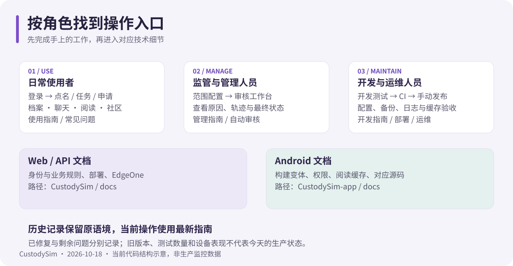

# 文档中心

核对日期：**2026-10-18**。本轮按当前双仓代码修订操作说明，示意图为本项目绘制，页面截图只使用隔离测试库的演示账号。

## 日常使用

| 文档                                  | 解决的问题                                         |
| ------------------------------------- | -------------------------------------------------- |
| [使用指南](user-guide.md)             | 登录、点名补卡、任务、申请、档案、聊天、阅读与社区 |
| [管理人员指南](staff-guide.md)        | 配置业务、集中审核、查看原因和轨迹、跟进异常       |
| [常见问题](faq.md)                    | 状态含义、提交失败、定位、阅读与缓存               |
| [App 服务器设置](server-selection.md) | 检测、切换、重新登录与数据隔离                     |

## 开发与运维

| 文档                                              | 解决的问题                                |
| ------------------------------------------------- | ----------------------------------------- |
| [系统架构](architecture.md)                       | 双仓边界、进程、数据和鉴权链路            |
| [开发与测试](development.md)                      | 初始化、双进程、测试隔离与命令矩阵        |
| [持续集成](ci.md)                                 | Web / Android 检查、产物、失败排查        |
| [生产部署](deployment.md)                         | 首次部署、增量更新、Nginx、自检与回退     |
| [配置参考](configuration.md)                      | 服务端环境变量、密钥、代理、可选服务      |
| [运维排障](operations.md)                         | Bash 日志、数据库连接、审核与阅读故障     |
| [数据库升级](database-web-performance-upgrade.md) | 增量升级清单、索引检查与回滚边界          |
| [原生客户端协议](android-client.md)               | Bearer / MFA / 刷新、定位、聊天与阅读契约 |
| [Android 开发入口](android-development.md)        | 独立 App 仓库与当前构建文档               |

## 功能专题

- [图书馆与有效阅读计时](library.md)
- [EdgeOne 图片、书籍和正文缓存](edgeone-media-cache.md)
- [自动任务与补卡审核](automatic-task-review.md)
- [匿名社区与自愿档案分享](community.md)
- [安全邮箱与腾讯云 SES](security-email.md)
- [业务数据库回归](../e2e/business/README.md) · [积分与禁闭回归](../e2e/scoring/README.md)
- [Android 文档中心](https://github.com/PDSB001/CustodySim-app/blob/main/docs/README.md)

本轮修订范围与验证见 [2026-10-18 文档修缮记录](maintenance-2026-10-18.md)。

## 审查与历史记录

| 记录                                                                                           | 如何使用                      |
| ---------------------------------------------------------------------------------------------- | ----------------------------- |
| [2026-10-17 修复跟进](code-review-follow-up-2026-10-17.md)                                     | 已落地修复与验证基线          |
| [剩余问题清单](../CODE-REVIEW-REMAINING-2026-10-17.md)                                         | 后续工作范围；不表示都已修复  |
| [原始代码审查](../CODE-REVIEW-2026-10-17.md) / [独立复验](../CODE-REVIEW-VERIFY-2026-10-17.md) | 当时快照，对照跟进清单阅读    |
| [历史设计与验证索引](archive/README.md)                                                        | 旧 UI、工具链、性能与迁移记录 |

历史文档保留当时的路径、版本和测试数据，页首明确标识其性质；执行命令时使用当前指南。图书馆历史设计见 [Web](library-web-design.md) / [App](library-app-design.md)。

## 文档维护规则

1. 改功能时同步指南；改环境变量时同步 .env.example、配置参考；改原生协议时同步双仓接口说明。
2. 当前指南标注核对日期；历史记录保留原日期，不把旧测试数量改成新结果。
3. 示例用 example.com 和占位标识，不写真实凭据、会话、业务截图或私有网络配置。
4. 图示须有可读文字、替代描述，并说明是结构示意还是实际截图。
5. 文档链接以仓库相对路径或另一仓库的公开链接为准，避免依赖某台机器的绝对目录。
