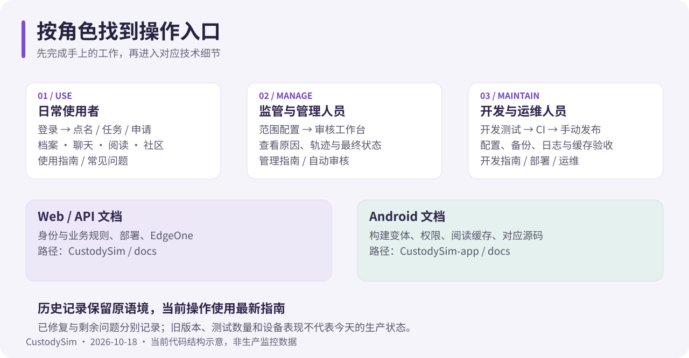

# 文档中心

本页是 CustodySim **Web / 服务端文档**的唯一入口：按「当前指南 → 功能专题 → 工程与运维 → 审查与历史」四层组织。Android 文档在独立仓库维护，见[跨仓边界](#跨仓边界)。

> 本页核对日期：**2026-11-01**。每份文档页首都标有自己的核对日期，内容以其页首为准；`2026-10-18` 批次的指南尚未逐条复核到 2026-11-01，引用具体数值前先对照当前代码与配置。

## 按角色进入

| 角色              | 先读                                                | 再查                                                                                                                      |
| ----------------- | --------------------------------------------------- | ------------------------------------------------------------------------------------------------------------------------- |
| 日常使用者        | [使用指南](user-guide.md)                           | [常见问题](faq.md) · [App 服务器设置](server-selection.md)                                                                |
| 监管人员 / 管理员 | [管理人员指南](staff-guide.md)                      | [自动审核](automatic-task-review.md) · [积分规则](scoring.md) · [操作审计](audit-logs.md) · [注册与考察](registration.md) |
| 开发者            | [开发与测试](development.md)                        | [系统架构](architecture.md) · [仓库目录](repository-layout.md) · [持续集成](ci.md)                                        |
| 运维人员          | [生产部署](deployment.md)                           | [配置参考](configuration.md) · [运维排障](operations.md)                                                                  |
| 新环境上线负责人  | [协议和账号权利上线准备](legal-launch-checklist.md) | [生产部署](deployment.md) · [配置参考](configuration.md)                                                                  |

## 日常使用

| 文档                                  | 解决的问题                                                 |
| ------------------------------------- | ---------------------------------------------------------- |
| [使用指南](user-guide.md)             | 登录、改密、打卡与补卡、任务、申请、档案、聊天、阅读与社区 |
| [管理人员指南](staff-guide.md)        | 配置业务、集中审核、查看原因与轨迹、跟进异常               |
| [常见问题](faq.md)                    | 状态含义、提交失败、定位、阅读与缓存的用户侧排查           |
| [App 服务器设置](server-selection.md) | 检测、切换、重新登录与数据隔离                             |

## 功能与规则

| 文档                                                   | 解决的问题                                                   |
| ------------------------------------------------------ | ------------------------------------------------------------ |
| [积分规则与排班切换](scoring.md)                       | 2026-11-01 起的打卡/任务口径、历史边界、禁闭双条件与排班替换 |
| [图书馆与有效阅读](library.md)                         | 上传与书架、阅读计时口径、阅读任务与阅读积分                 |
| [通知与合并公示](notifications.md)                     | 通知受众与确认、系统事件的合并规则                           |
| [App 通知与友盟推送](app-push.md)                      | 投递队列、实时进程复核、设备绑定与推送渠道                   |
| [匿名社区](community.md)                               | 发帖与评论、图片端点、删除级联、自愿档案分享                 |
| [Web 自由注册与首周考察](registration.md)              | 开放/暂停注册、默认监室、七个上海自然日考察、邮箱与网络风控  |
| [操作审计](audit-logs.md)                              | 审计页筛选与游标分页、详情脱敏、保留期与只读边界             |
| [安全邮箱与腾讯云 SES](security-email.md)              | 绑定/换绑/验证码链路、SES 配置与 MFA 的关系                  |
| [自动任务与补卡审核](automatic-task-review.md)         | 模型审核的触发条件、置信度阈值、并发预算与转人工             |
| [EdgeOne 图片、书籍与正文缓存](edgeone-media-cache.md) | 鉴权、共享字节、边缘函数与 App 本地缓存的配置顺序            |

## 工程与运维

| 文档                                                                                     | 解决的问题                                    |
| ---------------------------------------------------------------------------------------- | --------------------------------------------- |
| [系统架构](architecture.md)                                                              | 双仓边界、两个服务进程、数据与鉴权链路        |
| [开发与测试](development.md)                                                             | 环境准备、双进程启动、测试隔离与命令矩阵      |
| [仓库目录与文件归属](repository-layout.md)                                               | 新文件放哪、哪些目录不入库                    |
| [持续集成](ci.md)                                                                        | Web / App 两条流水线、检查项、产物与失败排查  |
| [依赖升级记录](dependency-upgrades.md)                                                   | 当前升级基线、兼容方案、安全告警与验证        |
| [生产部署](deployment.md)                                                                | 首次部署、增量更新、Nginx、自检与回退         |
| [配置参考](configuration.md)                                                             | 环境变量、密钥、代理、可选服务                |
| [运维排障](operations.md)                                                                | Bash 日志、数据库连接、审核与阅读故障         |
| [Web 性能数据库升级](database-web-performance-upgrade.md)                                | 性能索引升级范围、`--check-db` 与回滚边界     |
| [原生客户端接入规格](android-client.md)                                                  | Bearer / MFA / 刷新令牌、定位、聊天与阅读契约 |
| [Android 开发入口](android-development.md) / [构建缓存](android-build-cache.md)          | Web 仓内仅保留入口，权威内容在 App 仓库       |
| [脚本导航](../scripts/README.md)                                                         | 每个运维、升级、验证脚本的用途与风险          |
| [业务数据库回归](../e2e/business/README.md) / [积分与禁闭回归](../e2e/scoring/README.md) | 集成测试如何固定到 `custodysim_e2e`           |

源站防护、接口限流、实时连接配额与 APK 边缘缓存见[抗滥用与 DDoS 防护](ddos-protection.md)。

## 审查记录

审查按日期归档，原报告、复验、修复与剩余事项分开保存；**归档不等于已修复**，后续结论以每批的修复与剩余清单为准。

| 记录                                                        | 性质                                      |
| ----------------------------------------------------------- | ----------------------------------------- |
| [生产积分负分排查](reviews/2026-11-01-scoring-diagnosis.md) | 2026-11-01 生产只读核查、成因与已执行修复 |
| [2026-10-17 批次](reviews/2026-10-17/README.md)             | 批次入口：原报告、独立复验、修复、剩余    |
| ├ [全仓代码审查报告](reviews/2026-10-17/original.md)        | 原始发现（当时快照）                      |
| ├ [独立复验](reviews/2026-10-17/verification.md)            | 逐条复核，纠正误判                        |
| ├ [修复记录](reviews/2026-10-17/fixes.md)                   | 已落地补丁与验证基线                      |
| └ [剩余问题清单](reviews/2026-10-17/remaining.md)           | 待处理范围；读前先看当前 diff             |

索引与阅读方法见[reviews/README.md](reviews/README.md)。

## 历史材料

历史文档保留当时的路径、版本与测试数据，页首标注其性质；执行命令请用当前指南，不要照抄历史步骤。

| 记录                                                                                                                                                  | 内容                                       |
| ----------------------------------------------------------------------------------------------------------------------------------------------------- | ------------------------------------------ |
| [历史索引](archive/README.md)                                                                                                                         | Web / Android / 维护记录的总入口           |
| [文档修缮记录 2026-10-18](archive/maintenance/2026-10-18.md)                                                                                          | 上一轮文档整体修订的范围与验证             |
| [Web 性能](archive/web/web-performance.md) · [UI 收尾](archive/web/web-ui-review-2026-10-02.md) · [Web 图书馆设计](archive/web/library-web-design.md) | 旧实现与当时的核验证据                     |
| [Android 归档](archive/android/)                                                                                                                      | 拆仓前方案、阅读器改造、真机性能与设备记录 |
| [文档配图](assets/README.md)                                                                                                                          | 可提交的图解与演示截图说明                 |

## 跨仓边界

- 本目录只维护 **Web / 服务端**。Android 的构建、发布、服务器设置与阅读器文档以 [CustodySim-app](https://github.com/PDSB001/CustodySim-app/blob/main/docs/README.md) 为准；本仓只保留[入口](android-development.md)、[原生协议](android-client.md)与[构建缓存索引](android-build-cache.md)。
- 原生客户端的接口契约变化必须同时更新[原生客户端接入规格](android-client.md)与 App 仓库说明；只改一侧会让旧 App 静默降级。

## 文档维护规则

1. 改功能时同步对应指南；改环境变量时同步 `.env.example` 与[配置参考](configuration.md)；改原生协议时同步双仓说明。
2. 当前指南页首写核对日期；历史记录保留原日期与原测试结果，不把旧数字改写成新结论。
3. 新增审查放 `reviews/YYYY-MM-DD/`，并区分原始报告、复验、修复与剩余事项；单次生产排查可放 `reviews/YYYY-MM-DD-<主题>.md`。
4. 示例统一用 `example.com` 与占位标识，不写真实凭据、会话、业务截图或私有网络配置。
5. 图示须有可读文字与替代描述，并说明是结构示意还是实际截图；可公开配图放 `assets/`，真实设备与诊断截图留在忽略的 `artifacts/`。
6. 链接用仓库相对路径或另一仓库的公开链接，不依赖某台机器的绝对目录；链接改路径时在同一提交里更新引用。
