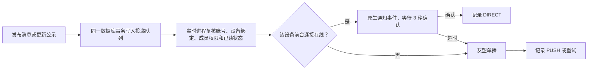

# App 通知与友盟推送

## 通知如何发送



- 在线状态按设备判断，浏览器在线不影响手机的离线推送。
- Android 前台使用独立 Socket.IO 连接，20 秒心跳，4 分钟更新凭证；退后台关闭。聊天不增加前台服务。
- 聊天接收人保持现有会话成员范围；投递时再检查账号、绑定版本、成员、组织/监管范围、撤回和已读。
- 聊天通知只显示发送者和“发来一条消息”。友盟载荷不含正文或图片；锁屏公开版本仅显示“你有一条新通知”。
- 客户端持久化投递 ID 去重。退出账号、会话失效或切换服务器会清除绑定和通知；迟到的旧绑定推送被忽略。
- 合并公示有内容更新才重新通知，历史合并归档不发送推送；手工发布和重新发布走相同队列。
- App“通知”中有消息通知总开关、站内信推送和打卡提醒开关。站内信默认开启；打卡提醒需主动开启，设置按当前服务器安装实例保存并同步服务端。总开关关闭时均不推送。
- 任务提醒默认随消息通知开启，可单独关闭。服务器每 5 分钟检查新发布任务、较长任务截止前 30 分钟、退回重做和审核通过；仅处理当前有效任务及最近 10 分钟的新发布/审核变化，停机恢复后不补发整批历史事件。提交后不再催办，审批状态变化后跳过旧审核事件。点击进入任务页，推送载荷不含任务标题、正文或审核意见。
- 聊天有两层免打扰：“通知”里的聊天总免打扰按设备生效，聊天会话内的免打扰按账号和会话保存、对该账号所有设备生效。服务端在入队和投递前都检查设置；不会影响消息保存、未读数和正常阅读。已由推送提供商接受的请求无法保证撤回，本机设置也会过滤迟到通知。免打扰接口复用当前会话访问权限，不能替其他账号修改。
- Web 聊天标题栏也提供“消息免打扰”开关，与 App 会话免打扰使用同一份服务端设置，直接控制该会话的 App 在线通知与离线推送。
- Web 和 App 匿名社区均提供“我的帖子”，服务端以当前登录账号筛选并分页，公共帖子和评论继续使用原有匿名序列化。客户端不能指定其他作者来查询“我的帖子”。
- 社区评论在保存评论的同一事务中为楼主入队；楼主自评不提醒。投递前复核评论和帖子仍存在、账号有效、评论未读。推送只含“你的帖子收到新评论”，不含评论者身份、帖子标题或正文；点击进入对应帖子最新一页评论。App 前台正在查看该帖时抑制额外系统通知。该帖已读评论由楼主通过鉴权接口按实际显示的评论 ID 标记。
- App“通知分类与免打扰”中可关闭社区回复通知；该分类随消息通知默认开启。服务器不会为未授权消息通知或未注册的设备创建推送绑定。
- 打卡使用服务器现有的 5 分钟状态巡检：开始后 10 分钟内提醒一次；开始已超过 20 分钟、距截止不超过 10 分钟时再提醒一次。短时段只提醒一次。每设备、任务、提醒阶段唯一入队；投递前复核在押状态、规则启用、任务待完成及截止时间，完成或过期后跳过。提醒可能延迟数分钟，不能替代用户按时打卡。
- 点击打卡提醒进入打卡页，点击站内信进入通知列表。Android 系统中“聊天消息”“站内信”“打卡提醒”是独立通知渠道，可分别调整声音等选项；锁屏不展示业务详情。
- 待处理任务持有数据库租约，失败最多尝试 5 次；超过 1 小时不再投递。PUSH 表示友盟 API 接受请求，不代表手机已实际展示。

## 私有配置

Web 自由注册账号的首周考察截止前一天也会入队提醒，沿用通知总开关与站内信分类开关。新版 App 点击后打开计分板；注册入口仍只在 Web。完整规则见[注册与考察](registration.md)。

Web 服务器 `.env.local`：

```dotenv
UMENG_PUSH_ENABLED=false
UMENG_APP_KEY=<AppKey>
UMENG_APP_MASTER_SECRET=<App Master Secret>
```

Android 仓库 `local.properties`：

```properties
custodysim.umengAppKey=<AppKey>
custodysim.umengMessageSecret=<Umeng Message Secret>
```

构建环境也可使用 `CUSTODYSIM_UMENG_APP_KEY`、`CUSTODYSIM_UMENG_MESSAGE_SECRET`。真实值不进入版本控制；Master Secret 只放服务器。生产/发布构建注入客户端参数，debug/debugR8 保持空值，避免误用生产应用的包名配置。客户端 SDK 初始化参数会存在 APK 中，不能作为服务端授权凭据。

## 部署和设备验证

1. 先部署 Web/API：`git pull --ff-only`，按现有流程运行 `bash scripts/deploy.sh`。脚本自动建立 `push_devices`、`push_deliveries`，不需要手工运行全库 schema push。
2. 给服务器配置上述私有变量；保持 `UMENG_PUSH_ENABLED=false` 时可以先验证前台直达。
3. 友盟控制台核对包名 `com.custodysim.app`，按控制台要求配置服务端 IP 白名单；服务端需要能访问 `https://msgapi.umeng.com`。
4. 本地构建 `production` 安装包。App 已按授权限定 `arm64-v8a`、`armeabi-v7a`，不支持 x86/x86_64 设备/模拟器。
5. 登录 App，在首页“通知”里选择“开启 App 消息通知”，同意友盟用途说明并授予系统通知权限。先从另一个测试账号发消息，验证前台提示、当前正在看的会话不额外提示。
6. 开启 `UMENG_PUSH_ENABLED=true` 并用现有 PM2 流程重新加载实时进程的环境。退后台测试离线通知，再验证点击进入会话、退出账号后忽略旧通知。
7. App 已安装 Firebase Messaging 和友盟 FCM 适配器。本地 `app/google-services.json` 必须包含正式包名，友盟控制台需配置 FCM HTTP V1 服务账号。服务账号私钥不放 App、不提交源码；客户端配置也保持忽略提交。启用通知、友盟注册成功、Google Play 服务可用后才注册 FCM。
8. 华为通道已集成到 App：发布构建需注入 `custodysim.huaweiAppId`（或构建环境变量 `CUSTODYSIM_HUAWEI_APP_ID`），且包名必须匹配 `com.custodysim.app`。在华为开发者联盟/AppGallery Connect 创建并启用 Push Kit，登记发布签名证书 SHA-256；在友盟 U-Push 的华为厂商配置中填写 Huawei App ID、Client Secret。Client Secret 只填友盟控制台，不进 App、服务器环境变量或 GitHub。按友盟文档在华为后台配置回执 `https://ack.upush.umeng.com/hw/`。U-Push 请求现带 `channel_activity`，华为离线通知点击后会回到 App 并经过本地账号绑定校验。仍需华为真机验证令牌注册、普通后台、划掉任务、点击跳转与回执；编译通过不代表已送达。
9. 华为通知若未申请自分类权益，可能按资讯营销类限频；若要让聊天、任务、打卡等服务通知稳定使用对应类别，需要在华为后台申请自分类消息权益，并根据获批类别配置 U-Push 消息分类。官方说明未申请权益时按资讯营销类处理，单设备每日可能仅 2 或 5 条。[华为消息分类说明](https://developer.huawei.com/consumer/cn/doc/harmonyos-guides/push-config-setting)。其他小米、OPPO、vivo、荣耀通道仍需各自后台参数和 SDK。通用通道不能保证 App 被系统强制停止后仍可送达。

### 仅打开 App 才收到通知

这通常表示通用连接重连后取到了积压消息，不能据此判定离线通道可用。服务端发送 U-Push 请求时必须携带 `channel_properties: { channel_fcm: "1" }`；仅安装 Firebase SDK 或在友盟后台启用 FCM，不会自动补上这项请求参数。当前 worker 已默认启用该参数，部署后由实时进程加载。

App 的“通知设置”提供推送连接状态，分别显示友盟注册与 FCM 检查结果。友盟注册失败不再被静默吞掉，前台后续连接会节流重试；“已取得 FCM 令牌”仅证明客户端注册成功，仍需后台服务账号配置正确、Google 服务可用，并做真实后台收信验收。状态页不会显示密钥、令牌或消息正文。

没有小米厂商账号的设备可以继续使用已配置的 FCM；不要把 Google 服务不可用时的离线送达作为保证。也不要通过后台常驻前台服务或反复自启代替系统推送。测试时分别记录普通退后台与系统强制停止，二者不等价。

如果 Google 接收日志已有 `Received`，随后却是 `No response to broadcast`，应继续检查系统是否允许该 App 后台启动，而不是继续修改服务端超时。小米设备可从应用信息检查“自启动”，并核对省电策略；App 通知设置提供“系统设置”入口，由用户决定这些权限。划掉最近任务在部分系统上会记录成 `FORCE STOP / SwipeUpClean`，也需要与普通返回桌面分开测试。参见[小米后台自启动说明](https://www.mi.com/global/support/faq/details/KA-507611/)。

查看队列，仅查询状态，不打印设备 token：

```sql
SELECT kind, state, error_code, count(*)
FROM push_deliveries
WHERE created_at > now() - interval '1 day'
GROUP BY kind, state, error_code;
```

## 已知 SDK 限制和验证边界

- 官方当前 U-Push 6.7.6 的 x86_64 tnet 不满足 16 KB 对齐，因此采用 ARM 安装包。
- `umdid:1.1.0` 的空 `checkClientTrusted` 位于出站 HTTPS 客户端，服务器链校验会委托系统 TrustManager；因此 lint 只对该构件的这项检查做限定例外，不全局关闭 TLS 检查。不过该 SDK 的服务器证书逻辑接受有效期异常，这是第三方实现限制，不能据此声称 SDK 的 TLS 行为与本 App 的 OkHttp 完全一致。应跟踪官方修复。
- `common:10.0.1` 在当前 R8 会报告缺少 stack map table 的第三方字节码警告；实际 R8 任务通过仍不能替代真机验证。
- 编译、数据库测试和模拟提供商响应不等于友盟真实注册/离线送达成功。上线前必须按第 5–6 步使用测试账号真机验收。

官方参考：[Android 集成](https://devs.umeng.com/docs/67966/detail/98585)、[服务端 API](https://devs.umeng.com/docs/67966/detail/68343)、[签名规则](https://devs.umeng.com/docs/67966/detail/149296)、[SDK 下载与版本](https://devs.umeng.com/sdk)。
