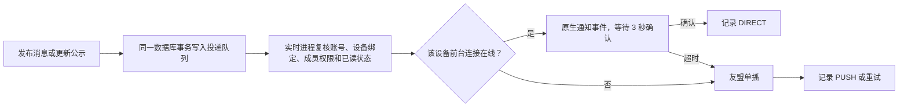

# App 通知与友盟推送

## 通知如何发送



- 在线状态按设备判断，浏览器在线不影响手机的离线推送。
- Android 前台使用独立 Socket.IO 连接，20 秒心跳，4 分钟更新凭证；退后台关闭。聊天不增加前台服务。
- 聊天接收人保持现有会话成员范围；投递时再检查账号、绑定版本、成员、组织/监管范围、撤回和已读。
- 聊天通知只显示发送者和“发来一条消息”。友盟载荷不含正文或图片；锁屏公开版本仅显示“你有一条新通知”。
- 客户端持久化投递 ID 去重。退出账号、会话失效或切换服务器会清除绑定和通知；迟到的旧绑定推送被忽略。
- 合并公示有内容更新才重新通知，历史合并归档不发送推送；手工发布和重新发布走相同队列。
- 待处理任务持有数据库租约，失败最多尝试 5 次；超过 1 小时不再投递。PUSH 表示友盟 API 接受请求，不代表手机已实际展示。

## 私有配置

Web 服务器 `.env.local`：

```dotenv
UMENG_PUSH_ENABLED=false
UMENG_APP_KEY=<AppKey>
UMENG_APP_MASTER_SECRET=<App Master Secret>
```

Android 仓库 `local.properties`：

```properties
custodysim.umengAppKey=<AppKey>
custodysim.umengMessageSecret=<Umeng Message Secret>
```

构建环境也可使用 `CUSTODYSIM_UMENG_APP_KEY`、`CUSTODYSIM_UMENG_MESSAGE_SECRET`。真实值不进入版本控制；Master Secret 只放服务器。生产/发布构建注入客户端参数，debug/debugR8 保持空值，避免误用生产应用的包名配置。客户端 SDK 初始化参数会存在 APK 中，不能作为服务端授权凭据。

## 部署和设备验证

1. 先部署 Web/API：`git pull --ff-only`，按现有流程运行 `bash scripts/deploy.sh`。脚本自动建立 `push_devices`、`push_deliveries`，不需要手工运行全库 schema push。
2. 给服务器配置上述私有变量；保持 `UMENG_PUSH_ENABLED=false` 时可以先验证前台直达。
3. 友盟控制台核对包名 `com.custodysim.app`，按控制台要求配置服务端 IP 白名单；服务端需要能访问 `https://msgapi.umeng.com`。
4. 本地构建 `production` 安装包。App 已按授权限定 `arm64-v8a`、`armeabi-v7a`，不支持 x86/x86_64 设备/模拟器。
5. 登录 App，在首页“通知”里选择“开启 App 消息通知”，同意友盟用途说明并授予系统通知权限。先从另一个测试账号发消息，验证前台提示、当前正在看的会话不额外提示。
6. 开启 `UMENG_PUSH_ENABLED=true` 并用现有 PM2 流程重新加载实时进程的环境。退后台测试离线通知，再验证点击进入会话、退出账号后忽略旧通知。
7. App 已安装 Firebase Messaging 和友盟 FCM 适配器。本地 `app/google-services.json` 必须包含正式包名，友盟控制台需配置 FCM HTTP V1 服务账号。服务账号私钥不放 App、不提交源码；客户端配置也保持忽略提交。启用通知、友盟注册成功、Google Play 服务可用后才注册 FCM。
8. 华为、小米、OPPO、vivo、荣耀等其他厂商通道需要各自控制台参数和 SDK。当前通用通道和 FCM 的集成不能据此保证被系统强制停止后仍可送达。

查看队列，仅查询状态，不打印设备 token：

```sql
SELECT kind, state, error_code, count(*)
FROM push_deliveries
WHERE created_at > now() - interval '1 day'
GROUP BY kind, state, error_code;
```

## 已知 SDK 限制和验证边界

- 官方当前 U-Push 6.7.6 的 x86_64 tnet 不满足 16 KB 对齐，因此采用 ARM 安装包。
- `umdid:1.1.0` 的空 `checkClientTrusted` 位于出站 HTTPS 客户端，服务器链校验会委托系统 TrustManager；因此 lint 只对该构件的这项检查做限定例外，不全局关闭 TLS 检查。不过该 SDK 的服务器证书逻辑接受有效期异常，这是第三方实现限制，不能据此声称 SDK 的 TLS 行为与本 App 的 OkHttp 完全一致。应跟踪官方修复。
- `common:10.0.1` 在当前 R8 会报告缺少 stack map table 的第三方字节码警告；实际 R8 任务通过仍不能替代真机验证。
- 编译、数据库测试和模拟提供商响应不等于友盟真实注册/离线送达成功。上线前必须按第 5–6 步使用测试账号真机验收。

官方参考：[Android 集成](https://devs.umeng.com/docs/67966/detail/98585)、[服务端 API](https://devs.umeng.com/docs/67966/detail/68343)、[签名规则](https://devs.umeng.com/docs/67966/detail/149296)、[SDK 下载与版本](https://devs.umeng.com/sdk)。
