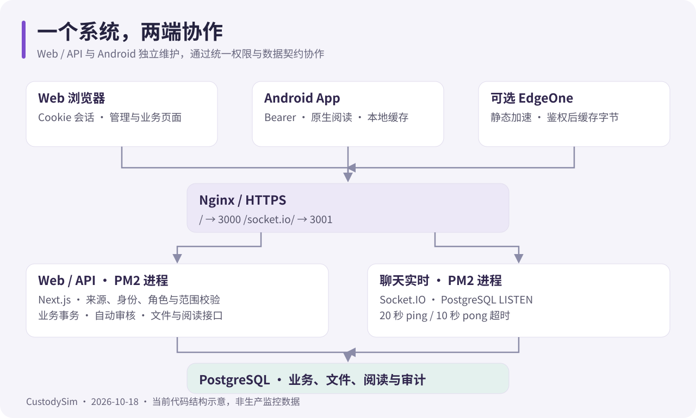
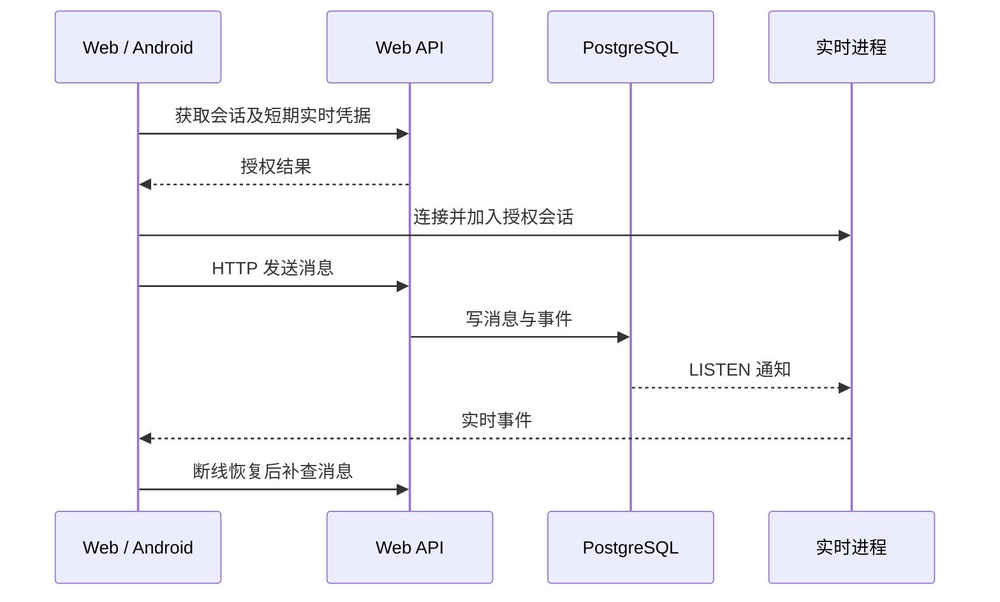

# 系统架构

核对日期：2026-10-18。本文描述仓库当前实现；生产拓扑、节点数量与具体域名以部署环境为准。

## 仓库与进程

| 部分           | 代码入口                                                  | 职责                                             |
| -------------- | --------------------------------------------------------- | ------------------------------------------------ |
| Web / HTTP API | [app](../app)、[components](../components)、[lib](../lib) | 页面、会话、权限、业务规则与数据库事务           |
| 聊天实时进程   | [realtime-server.mjs](../realtime-server.mjs)             | Socket.IO、PostgreSQL LISTEN、实时通知与维护任务 |
| 数据库         | [schema.ts](../lib/db/schema.ts)                          | 账号、组织、业务、文件字节、阅读与审核记录       |
| Android        | [独立仓库](https://github.com/PDSB001/CustodySim-app)     | 原生 UI、认证 HTTP、定位、聊天和原生阅读器       |
| 可选边缘函数   | [media-cache.js](../deploy/edgeone/media-cache.js)        | 实时远程鉴权后共享资源字节，不缓存权限结果       |

PM2 当前每个服务配置 1 个 fork 进程，Web 端口 3000，实时端口 3001；见 [ecosystem.config.cjs](../ecosystem.config.cjs)。增量部署复制 standalone 静态资源，再升级数据库并重启。

## 一次普通业务请求

1. 浏览器以会话 Cookie 请求；Android 使用 Bearer，并在写请求携带 android-app/2 客户端头。
2. Web 校验身份、账号状态、来源及业务范围。
3. 写操作在对应业务事务内保存状态、积分及审计；并发时重新核对状态。
4. 客户端依据服务端确认结果更新界面。客户端隐藏按钮不能代替服务端授权。

Authorization 头存在时只按该头校验，不回退 Cookie。原生标识只用于识别协议及来源校验，不能充当身份凭据。协议见[原生客户端接入](android-client.md)。

## 聊天链路

HTTP 负责会话、消息持久化、图片和补查。WebSocket 通过 /socket.io/ 转发至独立实时进程，使用按会话签发的短期凭据；心跳不延长授权有效期。

20 秒服务端 ping、10 秒 pong 超时可避免 300 秒空闲断线；断网仍需重连、重新授权和 HTTP 补查。代理配置见[部署指南](deployment.md)。

## 阅读与缓存链路

- 个性化 API、元数据、阅读进度与鉴权不共享缓存。
- EdgeOne 只在实时鉴权成功后返回允许共享的字节；正文剥离个人字段，用户 readerKey 来自当次授权响应头。
- App 的 128 MiB 阅读磁盘缓存独立于 25 MiB OkHttp HTTP 缓存。每次开书先请求元数据校验权限与版本，再复用本地内容。
- 计时由服务器记录有效心跳；下载快慢、本地缓存或页面计时动画不能自行增加积分。

细节见[图书馆](library.md)、[缓存配置](edgeone-media-cache.md)及 [App 阅读说明](https://github.com/PDSB001/CustodySim-app/blob/main/docs/reader-cache.md)。

## 外部服务与数据

GLM / z.ai 是可选自动审核服务，仅向所选服务商发送本次文本要求和回答；图片、现场核验等保留人工。腾讯地图浏览器 key 公开但应限制域名；SES、模型和 MaxMind 密钥留在服务器。电子书原文件、图片与业务数据存储在 PostgreSQL，备份不能只保存 Git 目录。

Web 使用 MIT；Android 组合应用使用 AGPL-3.0-only 并随分发 APK 提供对应源码。详见双仓许可文件。
