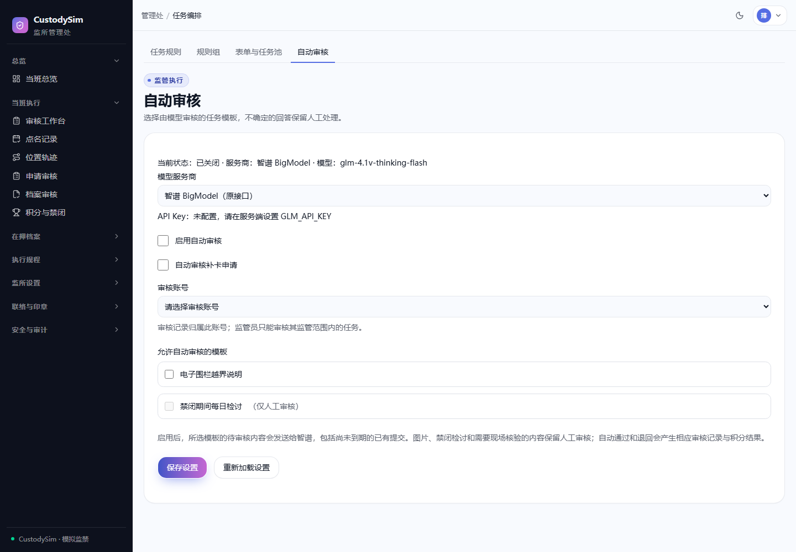
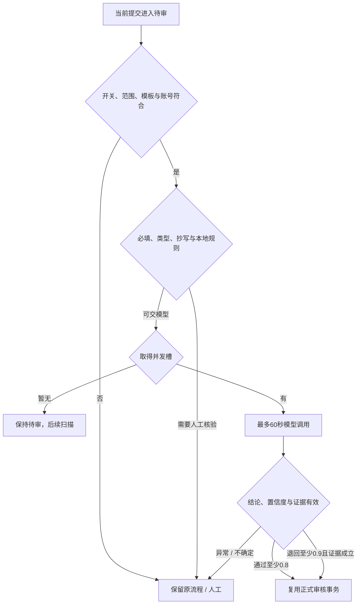

# 自动任务与补卡审核

核对日期：2026-10-18。自动审核默认关闭，任务与补卡保留人工入口；模型不是身份核验、现场核验或图片审核的替代。

_隔离测试库实际页面：未配置密钥、未启用外部调用。_

## 配置服务商

| 管理页选择            | 固定接口                                              | 当前模型                | 服务端密钥  |
| --------------------- | ----------------------------------------------------- | ----------------------- | ----------- |
| 智谱 BigModel（默认） | https://open.bigmodel.cn/api/paas/v4/chat/completions | glm-4.1v-thinking-flash | GLM_API_KEY |
| z.ai                  | https://api.z.ai/api/paas/v4/chat/completions         | glm-4.5-flash           | ZAI_API_KEY |

升级保留原 BigModel 为默认，可在管理页切换提供商。密钥不会跨服务商回退或转发，页面只显示是否配置。当前管理流程不按 GLM_REVIEW_MODEL 环境变量选择 4.7；提供商默认模型由 [glm-review-config.ts](../lib/glm-review-config.ts) 固定。

服务商当前可用模型、额度、地区和套餐限制以账号控制台与[官方定价](https://docs.z.ai/guides/overview/pricing)为准；项目配置不保证任意账号永久免费或必然可调用。

## 启用步骤

1. 先正常部署。scripts/deploy.sh 已接入 upgrade-auto-review.mjs；旧设置补默认 bigmodel，不需要手工 db:push。未升级时页面给出提示，保持人工可用。
2. 在 .env.local 保存所需服务商密钥，重启服务加载。密钥不填入前端，不提交 Git。
3. 管理员打开「任务编排 → 自动审核」（/auto-review），选择服务商、审核账号和允许的模板。
4. 打开「启用自动审核」，按需勾选独立的「自动审核补卡申请」，保存。
5. 用允许外传的虚构样本验证，再抽查真实适用模板的处理结果。

审核账号必须启用、完成首次改密，角色为 ADMIN/SUPERVISOR；监管员仍限其辖区。使用专用可追溯账号。模板必须有明确要求，禁闭检讨始终人工。

开关、账号、模板与服务商存数据库，保存后下次扫描读取，最多约一分钟。旧 AUTO_TASK_REVIEW_* 环境变量不控制新开关。更改范围或关闭后，尚未落库的旧结论重新校验配置，不覆盖新设置、人工处理或新提交。

## 规则与门槛

内容基本覆盖核心要求即可通过，允许简短、口语化、轻微错字和不影响理解的遗漏；不额外要求模板没写的字数、完整流程、深入反思或改进计划。

通过门槛 0.8，退回仍 0.9。低置信、矛盾或原回答中找不到退回证据转人工。置信度由模型自报，不是准确率保证。图片、禁闭检讨及明确现场核验/签字要求保留人工；必填、字段类型与抄写一致性仍由程序检查。

纯文字补卡理由能理解、与漏打卡相关即可基本通过，允许简短日常原因；不额外要求完整经过、详细时间或证明。空白/无关/无意义内容不合格，含图片或不能理解时转人工。补卡开关独立于任务模板选择。

## 并发、超时与暂停

每分钟扫描，任务和补卡各最多串行处理 3 项，每次模型请求最多 60 秒；过期运行 10 分钟后回收为人工。HTTP 错误、限流、超时、非法 JSON 或截断不循环重试，记录降级原因。

当前配置上限来自项目保守默认：4.1v 为 5、4.5 为 2、4.7 为 1（当前管理页不选用 4.7）。GLM_REVIEW_MAX_CONCURRENCY 可配置整数 1–50，但最终仍受连接预算限制，不能把这些数当供应商权益承诺。

每 Web 进程的所有模型合计最多占 min(5, floor(DATABASE_POOL_MAX / 4)) 条连接；服务商/模型槽用 PostgreSQL 会话 advisory lock 跨进程协调。扩容要同时核算连接总数。

池不足 4 时，管理页显示“模型审核暂停”及原因，日志去重告警；不新建运行、不改变待审状态，也不阻止网站启动。暂无槽位则留到后续扫描，人工始终可用。

## 去哪里看结果和原因

在「审核工作台」处理任务与补卡；补卡卡片显示转人工原因，审核轨迹记录自动结果、理由、配置模型、时间及后续人工决定。人工处理后仍保留自动历史，重新申请的旧运行标为历史申请。

“配置模型”表示该运行配置，本地规则直接转人工时不一定调用模型。同一提交版本只领取一次，降低标准后不会自动重跑已经转人工的旧版本。

通过/退回复用正式事务，包括状态、积分、印章和审计；网络调用不持有业务事务锁，返回后重查权限、状态、时间戳及内容。待审不会自动延长任务截止。

## 数据与验证边界

向外部发送本次模板要求与文本回答，不主动附人员档案、账号或历史积分；回答本身若含个人信息仍会外传，管理员只应启用合适模板。

单测与数据库回归使用受控模型响应，验证失败降级、并发、幂等、暂停与状态变化；不向模型发送业务测试数据。本地模拟通过不代表真实模型质量、当前套餐可用性或生产表现已验收。日志与数据库排查见[运维手册](operations.md)。
