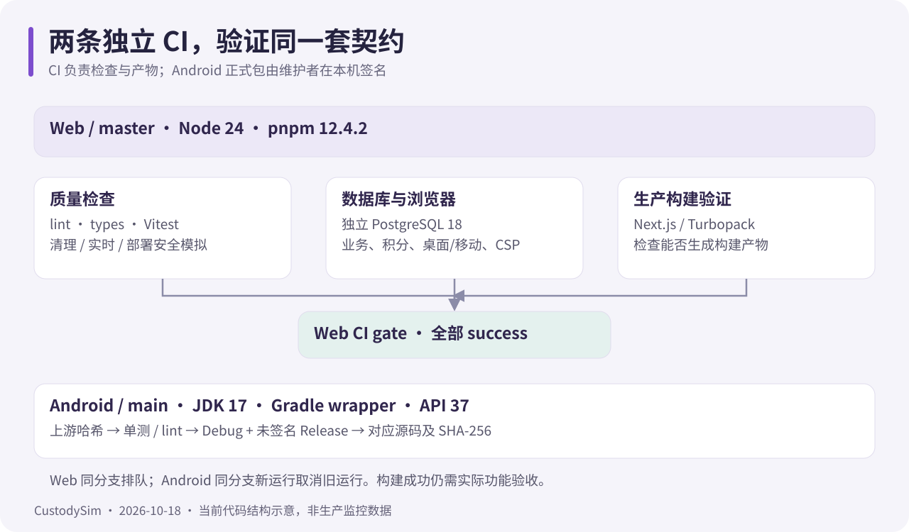

# 持续集成

核对日期：2026-10-18。双仓各自运行 GitHub Actions，只做检查与构建产物。正式 Android APK 由维护者本机签名。

## Web / API

入口为 [.github/workflows/ci.yml](../.github/workflows/ci.yml)，主分支 master；PR、推送、手动运行和 workflow_call 触发。

| Job                             | 内容                                                                                                     |
| ------------------------------- | -------------------------------------------------------------------------------------------------------- |
| Lint, types and unit tests      | workflow 静态检查、ESLint、TypeScript、Vitest、三组运维安全模拟                                          |
| Database and browser regression | PostgreSQL 18、测试库初始化、本地 IP 库下载、排程升级重复执行、积分 API、业务 API、普通浏览器、评分/安全浏览器、生产 CSP |
| Next.js build                   | 单独生产构建                                                                                             |
| Web CI gate                     | 三个上游均 success 才通过                                                                                |

Ubuntu 24.04；Node 从 .node-version 读取（当前 26.12.1），pnpm 从 packageManager 读取（当前 12.14.0），依赖使用 frozen-lockfile。Web 同分支运行排队，**不自动取消**前一个运行。

临时服务中的 custodysim_ci 与真正执行回归的 custodysim_e2e 分开；测试密钥为公开一次性值。业务、积分和浏览器套件顺序执行，禁止复用业务数据库或外部真实服务。测试库配置细节见[开发指南](development.md)。

### 生产 CSP 回归

`pnpm test:e2e:production` 构建真实 standalone，并在本地桌面和移动视口检查 nonce/strict-dynamic、普通页面、动态地图脚本、eval 与 Blob Worker。监听 securitypolicyviolation；SDK 由测试替身提供，不访问真实地图服务。

启动器在构建前校验 custodysim_e2e 和本地 HTTP 来源。浏览器入口对 Zod 使用 jitless，避免 Function 特性探测触发 CSP；普通页面继续禁用 unsafe-eval。Windows 仅规范 standalone 内部生成目录链接，不处理仓库外文件。

### 失败怎么查

1. 先看实际失败 Job 和第一条断言，而不是只看末尾 ECONNRESET。
2. 浏览器失败下载 web-test-results-*，检查 trace 与 error-context；报告保留 7 天。
3. “flaky”表示重试后通过，仍需检查首次失败；skipped 不等于测试成功。
4. 数据库失败先看隔离库初始化与结构升级，避免同时启动其他会写该库的套件。
5. gate 失败向上看：失败、取消、跳过的上游都不放行。

分支保护建议要求 **Web CI gate**；不要通过整份 workflow 路径过滤造成必需检查永久等待。

## Android

详见 [App CI](https://github.com/PDSB001/CustodySim-app/blob/main/docs/ci.md)。源码与 workflow 都提交到独立 App 仓库 main。

| 项目         | 当前行为                                                  |
| ------------ | --------------------------------------------------------- |
| 环境         | Ubuntu 24.04、JDK 17、仓库 Gradle wrapper、API 37         |
| 校验         | workflow、wrapper、Episteme 文件哈希                      |
| 构建         | Debug 单测 / lint / APK、未签名 Release APK、对应源码归档 |
| 产物         | APK、源码 ZIP、COMMIT.txt、SHA256SUMS，保留 14 天         |
| 报告         | 测试与 lint，保留 7 天                                    |
| 并发         | 同分支新运行**取消**旧运行                                |
| 必需检查建议 | Android CI gate                                           |

warnings-as-errors 保留；只排除构建文件明确列出的依赖更新与日志风格提示。不保存签名材料、私有端点或正式发布凭据。构建成功不证明真机手势、帧率或正式签名连续性。

## 维护规则

两份 workflow 仅申请 contents: read；第三方 Action 固定 SHA。Dependabot 每周检查 Actions 及各自的 npm / Gradle 依赖，兼容的 minor/patch 更新合组，仍需人工审查和 CI；兼容方案与升级结果见[依赖升级](dependency-upgrades.md)。工具版本以仓库配置为准，不临时安装浮动替代版。新增上游阅读器文件通过 vendor 脚本更新 UPSTREAM.json；调整原生协议时同时回归 Web 和 App。
