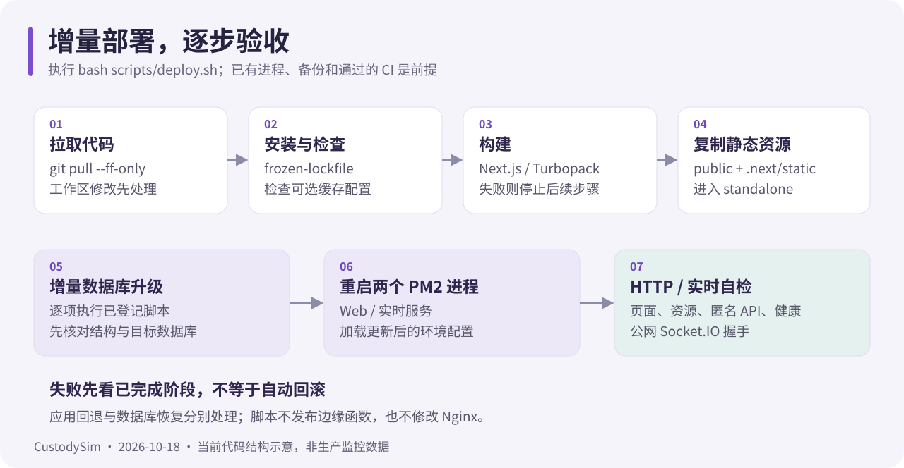

# 生产部署

核对日期：2026-10-18。以下 Bash 假设仓库在 ~/CustodySim，使用同一个非 root 部署用户管理 PM2。域名 example.com 是占位符。



## 先选入口

| 场景                   | 入口                                 | 需要知道                                                                                         |
| ---------------------- | ------------------------------------ | ------------------------------------------------------------------------------------------------ |
| 首次部署新库、创建进程 | 根目录 bash deploy.sh                | 安装、GeoIP（已配置时）、lint/types/test/build、尝试备份、交互 strict schema push、创建/重载 PM2 |
| 已上线环境增量更新     | bash scripts/deploy.sh               | 自动 git pull --ff-only、安装、缓存配置检查、构建、复制资源、增量升级、PM2 restart、自检         |
| 只看性能索引状态       | bash scripts/deploy.sh --check-db    | 只检查三个性能索引；不等于全库结构一致性检查                                                     |
| 回滚上述三个索引       | bash scripts/deploy.sh --rollback-db | 不回滚应用、其他表列、业务数据或整个数据库                                                       |

两份脚本都不是备份恢复系统。增量脚本不备份、不运行 lint/types/test、不执行全量 schema push，也不能代替首次创建 PM2 进程。

## 首次部署

1. 准备 Node 24、pnpm 12.14.0、PostgreSQL、PM2、Nginx 与 HTTPS 证书。源站应用端口只允许可信代理或受控网络访问。
2. 克隆仓库，复制 .env.example 为 .env.local。填写 DATABASE_URL、独立随机密钥、APP_ORIGIN=https://example.com 和 AUTH_COOKIE_SECURE=true，见[配置参考](configuration.md)。
3. 使用新的空数据库运行：

```bash
cd ~/CustodySim
bash deploy.sh
```

根脚本会交互展示 schema 变更。已有业务库不要将此流程当作无审查自动升级；必须先确认备份可恢复。脚本找不到 pg_dump 或连接串会跳过备份，不能把“运行过脚本”视为备份保证。

4. 尚无管理员时，用一次性环境变量初始化，密码不写命令行：

```bash
read -r -p '初始管理员账号: ' INITIAL_ADMIN_USERNAME
read -r -s -p '初始管理员密码: ' INITIAL_ADMIN_PASSWORD
printf '\n'
export INITIAL_ADMIN_USERNAME INITIAL_ADMIN_PASSWORD
pnpm db:bootstrap-admin
unset INITIAL_ADMIN_USERNAME INITIAL_ADMIN_PASSWORD
```

在 Web 首次登录完成改密；生产不运行演示 seed。

5. 配置 Nginx，按下面项目验收。运行 pm2 startup 并按输出注册启动服务，最后 pm2 save。不要混用 sudo pm2 和部署用户的 PM2。

## 日常增量更新

先保证远端已有要部署的提交，且 CI 通过。服务器保存配置与一致性数据库备份，并记录旧提交：

```bash
cd ~/CustodySim
git status --short
git rev-parse HEAD
pm2 list
```

确认没有需要保留的源码修改，两个 PM2 进程均已存在，然后执行：

```bash
git pull --ff-only
bash scripts/deploy.sh
```

脚本自身也会 pull；外层拉取让本次运行直接使用远端最新脚本。脚本执行的增量升级包括：

| 升级入口                       | 内容                               |
| ------------------------------ | ---------------------------------- |
| upgrade-web-performance.mjs    | 三个性能索引                       |
| upgrade-chat-caption.mjs       | 聊天图片说明                       |
| upgrade-review-snapshot.mjs    | 任务批阅快照                       |
| upgrade-community.mjs          | 匿名社区与档案自愿分享             |
| upgrade-library.mjs            | 图书馆、阅读、管理、内容版本生成列 |
| upgrade-isolation-schedule.mjs | 禁闭特化任务排程                   |
| upgrade-auto-review.mjs        | 自动任务 / 补卡审核及服务商设置    |

这些升级按脚本各自的锁、事务和校验执行，可重复运行；不是全量迁移器。新增其他结构必须审查兼容方案，不能默认脚本覆盖全部 schema。升级失败会停止后续步骤，先核查原因，不要直接跳过数据库升级启动新代码。

本轮 2026-10-17 审查修复不要求新增环境变量或数据库迁移。可选 CDN、邮件、模型服务仍按各自指南配置。

## Nginx 与可信代理

先用 sudo nginx -T 找到实际加载的站点文件，保存备份。下面是站点骨架：替换域名与已经签发的证书路径，并保留服务器已有必要安全配置；不要额外创建冲突的同域 server 块。

```nginx
server {
    listen 80;
    listen [::]:80;
    server_name example.com;
    return 301 https://$host$request_uri;
}

server {
    listen 443 ssl;
    listen [::]:443 ssl;
    server_name example.com;
    ssl_certificate /etc/letsencrypt/live/example.com/fullchain.pem;
    ssl_certificate_key /etc/letsencrypt/live/example.com/privkey.pem;

    client_max_body_size 26m;

    location /socket.io/ {
        proxy_pass http://127.0.0.1:3001;
        proxy_http_version 1.1;
        proxy_set_header Upgrade $http_upgrade;
        proxy_set_header Connection "upgrade";
        proxy_set_header Host $host;
        proxy_set_header X-Real-IP $remote_addr;
        proxy_set_header X-Forwarded-For $proxy_add_x_forwarded_for;
        proxy_set_header X-Forwarded-Proto $scheme;
        proxy_read_timeout 120s;
        proxy_send_timeout 120s;
        proxy_buffering off;
    }

    location / {
        proxy_pass http://127.0.0.1:3000;
        proxy_http_version 1.1;
        proxy_set_header Host $host;
        proxy_set_header X-Real-IP $remote_addr;
        proxy_set_header X-Forwarded-For $proxy_add_x_forwarded_for;
        proxy_set_header X-Forwarded-Proto $scheme;
    }
}
```

/socket.io/ 的 proxy_pass 不附尾斜杠路径；检查已有正则 location 是否改变匹配。片段见 [Socket.IO](../deploy/nginx/socket-io.conf) 与[上传限制](../deploy/nginx/library-upload.conf)。

```bash
sudo nginx -t && sudo systemctl reload nginx
```

使用 CDN 时，Nginx 必须先依据供应商可信回源网段恢复真实访客地址，再覆盖传给应用的 X-Real-IP。只有应用入口无法被不可信来源绕过、代理头可信时，才启用 TRUST_PROXY=true；不要直接信任任意客户端传来的 X-Forwarded-For。这里的示例本身不会自动完成 CDN real-ip 配置。

80 端口访问裸 IP 是否展示站点取决于 Nginx 默认虚拟主机，不是应用健康验证。需要限制时配置独立默认站点；不要据此删除正常域名站点。

## 部署验收

```bash
pm2 list
curl -i http://127.0.0.1:3000/login
curl -i http://127.0.0.1:3000/window.svg
curl -i http://127.0.0.1:3000/api/me
curl -i http://127.0.0.1:3001/health
curl -i 'https://example.com/socket.io/?EIO=4&transport=polling'
```

预期依次为登录 200、静态资源 200、匿名 API 401、实时健康 200、握手 200 且正文以 0{"sid": 开头。HTTP 握手通过后，再验证登录、聊天双向收发、图片、任务与补卡原因、书籍阅读及计时。

启用 EdgeOne 时还需[缓存验收](edgeone-media-cache.md)：HIT、完整传输、当前权限和正文显示必须同时正确。增量脚本不会发布边缘函数或修改 Nginx。

## 失败与回退

这不是原子或零停机部署。构建直接更新当前目录产物，数据库升级也可能已部分成功；失败后先看进程、日志和已完成阶段，不要反复切换旧代码尝试修复结构。

- 构建失败：保留输出，查看 PM2 实际状态，不假定旧服务完全不受影响。
- 数据库升级失败：核对目标库和脚本报错；已成功的增量不会自动撤销。
- 重启 / 自检失败：检查 Web 与实时日志，见[运维排障](operations.md)。
- 应用回退：先验证旧代码与已升级数据库的兼容性；记录的 Git 提交不等于数据库恢复点。
- 数据恢复：使用已验证备份和审查过的恢复流程，先在隔离库验证。

向使用者交付 HTTPS 入口、对应 App 版本、账号领取方式和[使用指南](user-guide.md)。说明可选服务是否启用及真实设备上尚未验收的能力。
