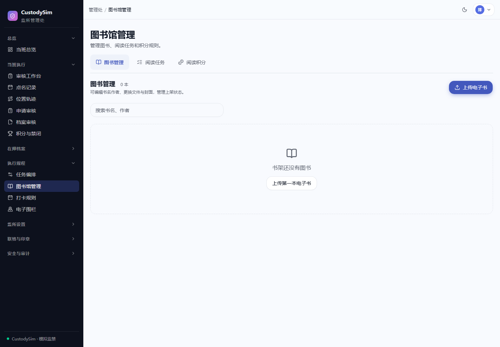

# 图书馆与有效阅读

核对日期：2026-10-18。阅读位置、时长与积分由 Web/API 统一维护，Android 使用原生阅读器。

_上图使用隔离测试库；不代表生产书架内容。_

## 上传与书架

管理员在图书馆的「图书管理、阅读任务、阅读积分」中操作。支持 PDF、EPUB、DOCX、UTF-8 TXT，原文件最大 20 MiB；PNG/JPEG/WebP 封面最大 3 MiB。Nginx 与 Next 请求体需容纳文件加封面，配置为 26 MiB。

原文件和封面存 PostgreSQL bytea，不依赖发布目录。EPUB 内置封面、DOCX 缩略图可自动提取；无封面显示占位，失败不会生成假封面。管理员可编辑书名作者、更换正文/封面、上下架或软移出书架。

下架保留管理可见性；软移出后所有角色的书架与阅读端点隐藏，保留历史数据。替换正文会结束旧会话、重置旧页码，累计有效时长保留。

## 各格式阅读路径

| 格式        | Web                                  | Android                       |
| ----------- | ------------------------------------ | ----------------------------- |
| PDF         | /file + PDF.js，保留页面             | /file + PdfRenderer           |
| EPUB / DOCX | /document 的净化章节、样式与可用资源 | Episteme 原生排版，非 WebView |
| TXT         | /document，Unicode 文本分页          | StaticLayout 原生文本引擎     |
| EPUB 插图   | /resource?path=...                   | 经认证资源仓库与磁盘缓存      |

EPUB 按 spine、目录与内容解析，不执行书籍脚本，不支持 DRM。净化后的排版不等于原出版物完全复刻；DOCX 也不保证复杂布局完全保留。Web 的 sandbox 阻止书籍脚本属于预期保护，不应为消除控制台提示而放开 allow-scripts。

跨端位置由阅读标识、内容版本与页码/锚点合约维护；字体、屏幕与排版引擎不同，视觉一页未必相同。不要用某个设备截图的物理页数推断累计时长。

## 计时、任务与积分

失焦、隐藏、App 不在 RESUMED、手动暂停或保存失败时停止有效计时；离线时间不补记。同一用户新会话关闭旧会话，防止跨设备同时计分。累计时长衡量前台停留，不能证明阅读理解。

阅读任务保存生成时的分钟要求快照，只计任务有效时间内的有效片段；达标后服务端自动通过，无需提交。修改规则只影响之后下发的任务，旧任务仍按原快照。没有 READING 标记的旧任务保留原流程。

阅读积分默认每 15 分钟 +1，每个上海日期最多 2 分，定位为补充项而不是主要加分来源；管理员可启停并调整分钟阈值，日上限最高仍可设到 3。仅对被监管人结算，双端共用额度。任务完成按原任务规则另计 TASK_OUTCOME，阅读计分为 READING_DURATION，同事务与唯一约束避免重复。

积分计分板按周汇总全部流水，阅读分不再单列成另一套总分：表格在「周积分」旁直接给出「其中阅读」分项，页面顶部有「阅读积分合计」，明细弹窗与规则公示也标明这一来源。分项与总分取自同一批 `score_events`，周结与禁闭判定因此自然包含阅读积分。

打卡自 2026-10-25 起改为按时段线性计分（完成 +1、补卡 -1、缺卡 -2），取消每日 5 分基线与 0 分地板；任务结果改为 +3 / +2 / -3。打卡只有"完成 / 补卡 / 缺卡"三档，`LATE` 只是截止后被清扫前提交的竞态，与完成同样计分。禁闭改为双条件：周积分为负 **且** 当周出勤率（完成 + 补卡通过）低于一半才触发，避免只被任务扣分但全勤的人被禁闭；没有打卡排班的周退回纯分数线判定。更早的日结保持原口径，不追溯重算（测试库用 `SCORE_SLOT_SCORING_START_DAY` 覆盖生效日）。

## 缓存和下载

源站解析缓存最多 8 本，序列化大小预算 24 MiB，进程重启清空；超出预算不保留。EdgeOne 可缓存原文件、公共正文和插图 7 天，但命中仍实时校验权限。App 阅读磁盘缓存默认 128 MiB，每次开书先 metadata 验证当前权限和内容版本。

当前 App 首次正文下载支持 shared-v1 与 gzip；旧 App 可继续正常回源。正文异常仅恢复一次 document-origin，不能让此路径触发正文边缘函数。详情见[EdgeOne](edgeone-media-cache.md)与[App 阅读缓存](https://github.com/PDSB001/CustodySim-app/blob/main/docs/reader-cache.md)。

## 升级与验收

正常 `bash scripts/deploy.sh` 调用 upgrade-library.mjs，依次应用：

1. 20261004-library.up.sql
2. 20261004-library-reading.up.sql
3. 20261004-library-management.up.sql
4. 20261011-library-cache.up.sql

各文件幂等，在各自事务中执行。内容版本 content_revision 由数据库生成，替换文件自动变化。已有文件升级会计算版本，需预留时间并先备份。

备份应包含图书馆五表、规则、模板与积分流水。验收上传/替换、章节中文插图、跳页、跨端位置、暂停恢复、重开缓存、下架后拒绝、计时和积分，不能只看 200/HIT。问题排查见[运维手册](operations.md)。
