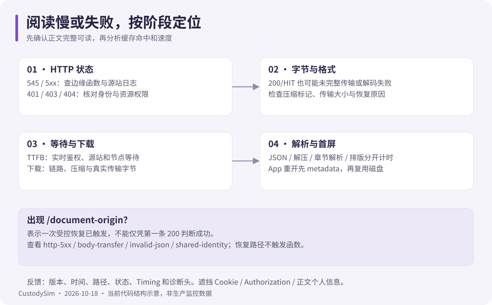

# 运维排障：Bash 操作手册

核对日期：2026-10-18。以下在已部署服务器的项目目录执行，不需要把 .env.local 或任何登录凭据发给别人。

## 先看版本与进程

```bash
cd ~/CustodySim
git log -1 --oneline
git status --short
pm2 list
pm2 logs custodysim --lines 100 --nostream
pm2 logs custodysim-chat-realtime --lines 100 --nostream
```

Web 文件日志为 .logs/error.log 与 .logs/out.log；实时日志为 .logs/chat-realtime-error.log 与 .logs/chat-realtime.log。进程 online 不代表数据库、会话和业务都健康，按[部署验收](deployment.md)继续检查。

## psql 连成 ubuntu 角色了

错误“role ubuntu does not exist”通常是当前 shell 没有 DATABASE_URL，psql 回退到了本地用户。Node/PM2 读取 .env.local 不会自动把变量导出到 Bash。

```bash
# 只在当前 shell 内载入连接串，不把它打印出来
DATABASE_URL="$(node --input-type=module -e '
  import { config } from "dotenv";
  config({ path: ".env.local", quiet: true });
  if (!process.env.DATABASE_URL) throw new Error("DATABASE_URL 未配置");
  process.stdout.write(process.env.DATABASE_URL);
')" &&
  export DATABASE_URL &&
  psql "$DATABASE_URL" -X -P pager=off -c 'SELECT current_database(), current_user;'
```

核对实际数据库后再查询。完成后 `unset DATABASE_URL`。不要直接 source 一个未经审查的配置文件；不要将含密码的连接串复制到命令、截图或工单正文。

## 自动审核没通过、也没报错

“无报错”不等于自动批准。先在管理端「任务编排 → 自动审核」看服务商、密钥状态、模板、审核账号、补卡开关与“模型审核暂停”提示。再在审核工作台打开原因和审核轨迹。

```bash
rg '\[auto-review\]' .logs/error.log .logs/out.log
```

没有安装 rg 时用 `grep -n '\[auto-review\]' .logs/error.log .logs/out.log`。审核原因可能含用户填写内容，分享日志或结果前脱敏。

只读查看近 20 条补卡与自动运行：

```sql
SELECT m.id, m.status, m.created_at,
       r.result, r.reason AS auto_review_reason, r.model,
       r.created_at AS auto_review_at
FROM checkin_makeups m
LEFT JOIN auto_review_makeup_runs r ON r.makeup_id = m.id
ORDER BY m.created_at DESC, r.created_at DESC
LIMIT 20;
```

这是一对多历史查询，单个补卡可显示多次运行；当前结论以审核工作台的当前申请版本为准。若只查 PENDING 得到零行，代表没有待审补卡，不是自动审核坏了。

| 现象               | 解释 / 后续动作                                    |
| ------------------ | -------------------------------------------------- |
| MANUAL 且有原因    | 已交人工处理；现场签字、图片、模型失败等会触发     |
| 无自动运行         | 检查开关、范围、账号资格、模板及是否已有同版本记录 |
| 模型审核暂停       | 连接预算不足；待审状态不变，人工仍可处理           |
| 已转人工后调整标准 | 同一提交不会自动重跑，走正常人工审核               |
| 审核已 APPROVED    | 当前记录已处理，保留历史自动原因是追溯需要         |

更细规则见[自动审核](automatic-task-review.md)。不要用 SQL 直接把状态改为通过，避免漏掉积分、印章与审计事务。

## 阅读加载失败、545、HIT 仍慢



1. 找到实际 /document 或 /file 请求，记录状态、Content-Type、传输大小、TTFB、内容下载时间和函数版本头。
2. 545 / 24 字节 / Error return from script 是平台通用失败，不能只凭它断定某个运行时异常。查看 EdgeOne 函数异常日志；临时撤掉精确 document 触发规则可恢复原鉴权接口。
3. 200/HIT 后出现 document-origin，表示传输、JSON 或共享身份检查触发了一次恢复，不表示第一条请求业务上已成功。看恢复请求的 X-CustodySim-Reader-Recovery-Reason。
4. HIT 仍慢时分开比较鉴权等待、文件传输、客户端解压解析和排版。几十 MB 的解码后 JSON 仍会耗时；检查 gzip-v1 与实际传输字节，不能只看“压缩已开启”开关。
5. App 重开仍下载正文时，核对当前 App 是否包含共享传输与 128 MiB 磁盘缓存、metadata 的 revision 是否稳定、是否切换了账号/服务器，以及缓存是否被系统回收。

EdgeOne 正文触发仅匹配 document，不能包括 document-origin 或 document*。完整配置、诊断头与关闭顺序见[缓存指南](edgeone-media-cache.md)。

## 聊天只能刷新后收到

先分别请求本机 /health 与公网 /socket.io/?EIO=4&transport=polling。健康 503 表示数据库 LISTEN 尚未就绪；公网 404/308 常见于代理落到了 Web。核对当前生效 Nginx、APP_ORIGIN 与构建期实时地址。

20 秒 ping / 10 秒 pong 超时用于空闲保活；浏览器后台、断网或 CDN 总寿命限制仍可断连。恢复后应重新加入会话并 HTTP 补查。日志出现 ECONNRESET 需结合具体请求和复现判断，不能仅凭单条断开日志认定业务失败。

## 备份与最小反馈

在确认连接目标后，备份示例：

```bash
umask 077
mkdir -p .backups
pg_dump --dbname="$DATABASE_URL" --format=custom \
  --file=".backups/pre-deploy-$(date +%Y%m%d-%H%M%S).dump"
```

先完成前面的连接载入与目标核对。成功生成文件仍需在隔离库试恢复验证；定期保存到独立受控存储，同时保护解密所需密钥。备份不入 Git。

反馈至少包含：版本/提交、发生时间、角色、路径、HTTP 状态、脱敏错误、复现频率。不要包含 Cookie、Authorization、验证码、恢复码、完整连接串或私钥。
